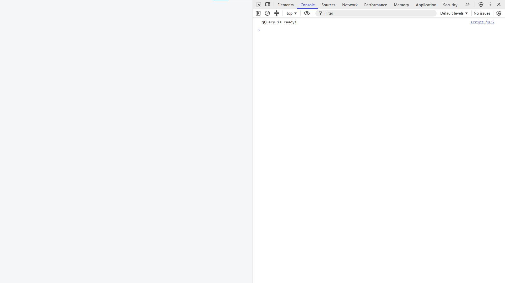

# Assignment 6 - JQuery
## Name: Magzhan Myktybay
## Group: SE-2540
## Part 1 Getting started by JQuery
### Task 0 Setup

We included JQuery by CDN and checked that DOM is fully rendered, at which point it invokes function, that prints "jQuery is ready!" to the console.
### Task 1 Selectors & CSS

The page shows my name, headline and a short introduction, plus a "Welcome to My Portfolio" section. I used three types of jQuery selectors: tag (`h2`), ID (`#headline`, `#greeting`) and class (`.intro`). The headline is changed with `.text()` and the greeting with `.html()`. The `.css()` method changes the color of all `h2` headings and the font size of `.intro` paragraphs. Two buttons switch between light and dark themes: on `.click()` they use `.css()` to change the colors of the `body` and all `.card` elements.