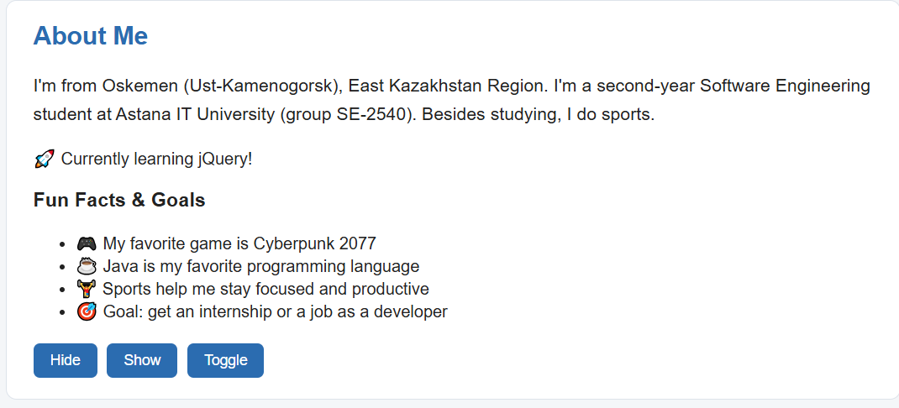
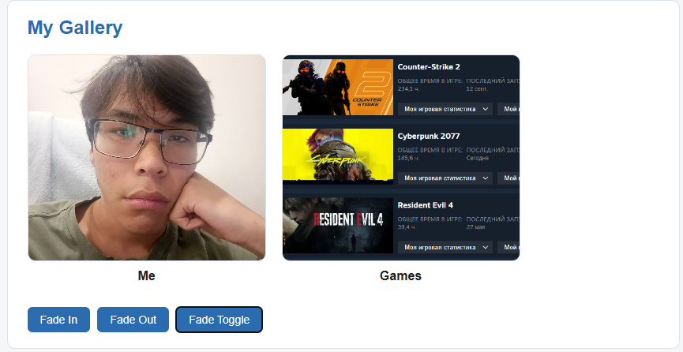
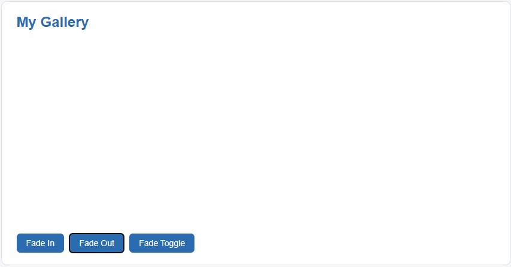
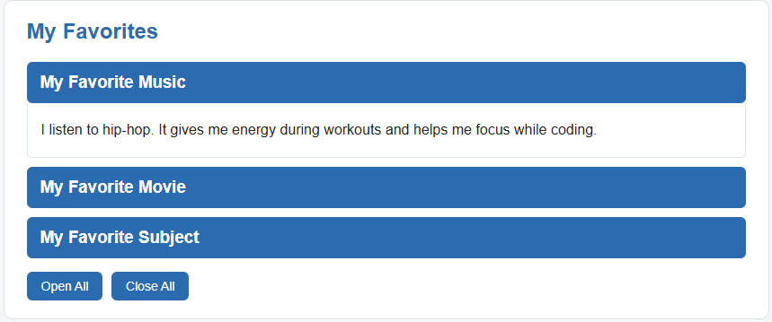
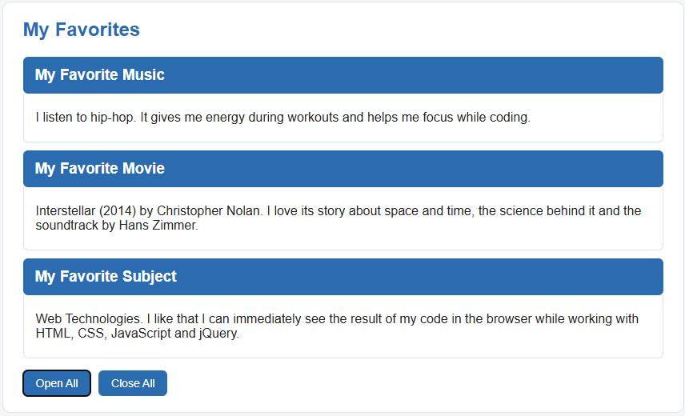
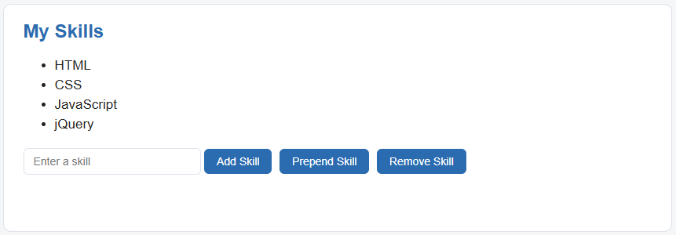
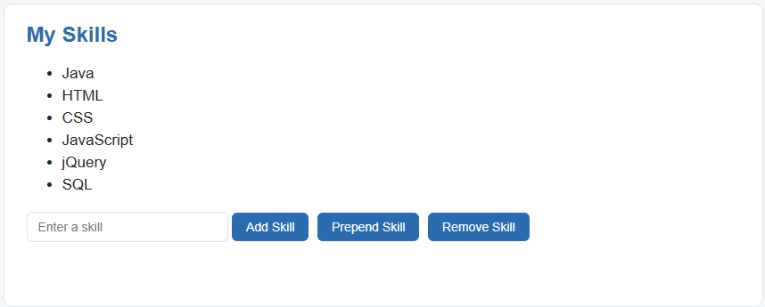
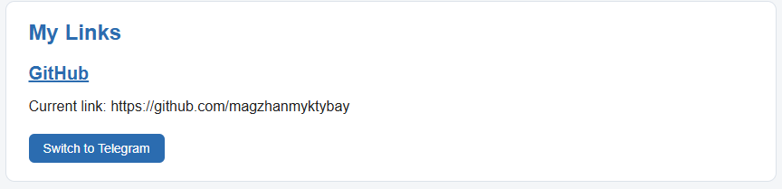
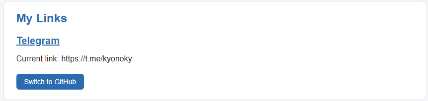

# Assignment 6 - JQuery
## Name: Magzhan Myktybay
## Group: SE-2540
## Part 1 Getting started by JQuery
### Task 0 Setup

We included JQuery by CDN and checked that DOM is fully rendered, at which point it invokes function, that prints "jQuery is ready!" to the console.
### Task 1 Selectors & CSS

The page shows my name, headline and a short introduction, plus a "Welcome to My Portfolio" section. I used three types of jQuery selectors: tag (`h2`), ID (`#headline`, `#greeting`) and class (`.intro`). The headline is changed with `.text()` and the greeting with `.html()`. The `.css()` method changes the color of all `h2` headings and the font size of `.intro` paragraphs. Two buttons switch between light and dark themes: on `.click()` they use `.css()` to change the colors of the `body` and all `.card` elements.
## Part 2 jQuery Effects
### Task 2 Visibility Methods

I created an "About Me" section with a short biography, a status message "Currently learning jQuery!" and a list of fun facts and goals (favorite game, favorite programming language, sports and my career goal). Three buttons control the visibility of the status message and fun facts: `.hide()` hides them, `.show()` shows them again, and `.toggle()` switches between hidden and visible. I passed the "slow" parameter to make the effect smooth. Both elements are selected at once with `$("#status, #funFacts")`.
### Task 3 Fade Methods

I created a gallery with two images: my photo and a picture about games. Three buttons control the visibility of the images: `.fadeIn()` smoothly shows them, `.fadeOut()` smoothly hides them, and `.fadeToggle()` switches between the two states. The duration is set to 800 milliseconds to make the effect smooth.
### Task 4 Slide Methods

I created three clickable headings: "My Favorite Music", "My Favorite Movie" and "My Favorite Subject". Each heading has a collapsible panel beneath it. Clicking a heading opens or closes its panel with `.slideToggle()`. The "Open All" button uses `.slideDown()` to open all panels, and the "Close All" button uses `.slideUp()` to close them.
## Part 3 DOM Manipulation with jQuery
### Task 5 Add & Remove Elements

I created a list of four technical skills (HTML, CSS, JavaScript, jQuery) and a text input for a new skill. The "Add Skill" button uses `.append()` to add the skill to the end of the list, and "Prepend Skill" uses `.prepend()` to add it to the beginning. The "Remove Skill" button finds the skill with the same name as in the input and deletes it with `.remove()`. The input value is read with `.val()` and `.trim()`, so empty skills cannot be added.
### Task 6 Modifying Attributes

I added a social media link to my GitHub profile. The button changes the link's destination with `.attr("href", ...)` to my Telegram, and clicking it again switches back to GitHub. The current link is read with `.attr("href")` and displayed below.
