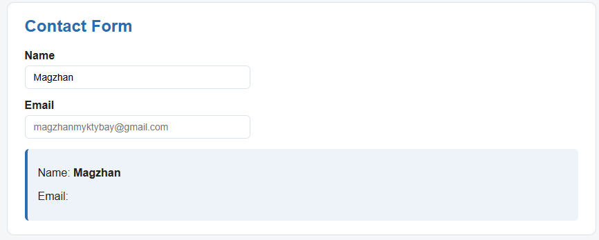
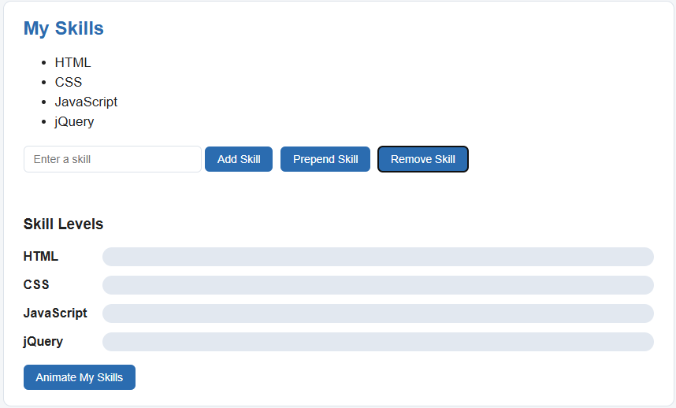
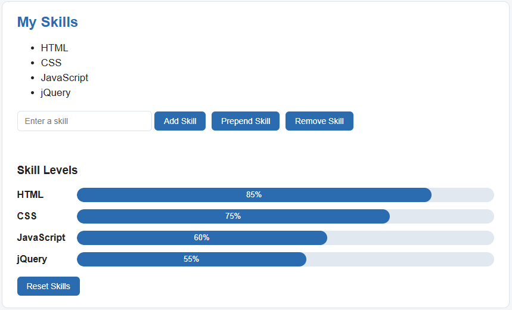

# Assignment 6 - JQuery
## Name: Magzhan Myktybay
## Group: SE-2540
## Part 1 Getting started by JQuery
### Task 0 Setup

I included JQuery by CDN and checked that DOM is fully rendered, at which point it invokes function, that prints "jQuery is ready!" to the console.
### Task 1 Selectors & CSS

My name, headline and an introductory statement can be seen in this page along with a "Welcome to My Portfolio" section. The jQuery selectors used include three different categories – tag (`h2`), ID (`#headline`, `#greeting`) and class (`.intro`). The modification of the headline has been done using `.text()` whereas the greeting has been modified using `.html()`. The color of all `h2` tags and the font-size of `.intro` tags have been changed using `.css()`. Light and dark themes can be toggled using the two buttons using `.css()` on `.click()`.
## Part 2 jQuery Effects
### Task 2 Visibility Methods

I made an "About Me" portion that included a brief biography, a status message that says "Currently learning jQuery!" and fun facts and goals (my favorite video game, my favorite programming language, sports and my career goal). Three buttons were made to display or hide the status message and fun facts: `.hide()` to hide the message, `.show()` to display it again and `.toggle()` to switch between displaying and hiding it. I used the "slow" parameter in order to get a better effect.
### Task 3 Fade Methods

I made a gallery of two pictures, my photo and the one related to games. There are three buttons that enable me to show/hide the pictures: `.fadeIn()` to show them, `.fadeOut()` to hide them and `.fadeToggle()` to change between these two. The time of the action lasts 800 ms.
### Task 4 Slide Methods

I made clickable headings named “My Favorite Music”, “My Favorite Movie” and “My Favorite Subject”. Every one of them has a panel which can be closed or opened. By clicking on one of the headings, its panel will be opened or closed by using `.slideToggle()`. “Open All” button opens all panels by using `.slideDown()` function and “Close All” does the same thing by using `.slideUp()` function.
## Part 3 DOM Manipulation with jQuery
### Task 5 Add & Remove Elements

A list of technical skills has been made containing HTML, CSS, JavaScript, and jQuery, while the fifth is a text box for entering a new skill. The button "Add Skill" adds the entered skill at the end of the list using `.append()`, and the button "Prepend Skill" adds the skill at the start of the list using `.prepend()`. The button "Remove Skill" searches for the skill that has the same name as the skill entered in the text box and removes it using `.remove()`.
### Task 6 Modifying Attributes

A social media URL has been added to my GitHub page. It updates the URL to point to my Telegram through `attr("href", ...)`, and upon being clicked again, redirects the URL back to my GitHub. The current URL is obtained through `attr("href")`.
### Task 7 Form Interaction

I have used a form containing Name and Email. As the user enters his name and email in the form, what he types gets displayed in real time below the form by using .val() and .text() functions.
## Part 4 Animations
### Task 8 Basic Animation

I extended Task 5 with skill bars for four skills: HTML, CSS, JavaScript and jQuery. These bars begin at zero width initially. The “Animate My Skills” button employs the `.animate()` method to expand these bars to their own widths (85%, 75%, 60%, 55%). These widths are defined in the data-level attribute. Upon clicking the button again, these bars will animate back to their initial width.
## Summary
For this assignment, I created my personal portfolio page using jQuery. I made use of selectors and .css() method to style elements, effects such as `hide/show/toggle`, `fade`, and `slide` for visibility, DOM manipulation methods such as `append`, `prepend`, `remove`, `attr`, `val` for changing the page content and `.animate()` for skill bars.
